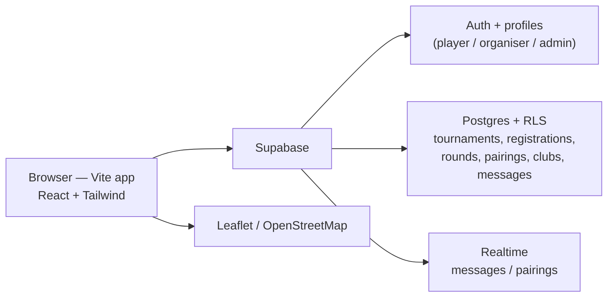

# Qehwa Chess ♟️☕

**Organise real-life chess tournaments, clubs and meetups in Morocco — find your people, play over the board.**

Qehwa Chess is a web platform for chess players, clubs and tournament organisers in Morocco. It helps people discover local tournaments and casual meetups, register, check in at the venue with a QR code, and follow pairings and standings — in English, French and Arabic.

> **What this is:** a tool to organise chess *in real life*.
> **What this is not:** an online chess game. There is no playable board, no online engine and no online rating. Games are played face-to-face, at a café, club or tournament hall; Qehwa Chess handles everything around the board.

<!-- TODO: replace with a real demo URL once deployed.
     A Vercel project exists (see PR #1, Vercel Analytics), but no public
     demo URL was confirmed in the repo at the time of writing.
     Do NOT ship this README with a guessed URL. -->
**Live demo:** _TODO — add the Vercel deployment URL here_

## Screenshots

_TODO — add screenshots before sharing this README widely._

Suggested shots, in `docs/screenshots/`:

| Home — map of Morocco | Tournaments | Tournament detail — check-in & pairings |
| --- | --- | --- |
| _to add_ | _to add_ | _to add_ |

| Organiser dashboard | Mobile check-in (QR scan) |
| --- | --- |
| _to add_ | _to add_ |

A 20–30 second GIF of “create a tournament → register → check in by QR → publish a round” is worth more than a paragraph of text.

## Features

- **Tournaments** — create, submit for admin approval, publish; draft / pending / published / cancelled / completed
- **Registration** — capacity, registration deadline, waitlist, entry fee (MAD), prize fund
- **Venue check-in** — QR code per confirmed player, scanned by the organiser at the door; single-use, organiser/admin only
- **Pairings & standings** — Swiss pairings with Buchholz and Sonneborn-Berger tie-breaks, board numbers, colour balancing; results entered by the organiser
- **Clubs** — club pages, memberships, club tournaments
- **Meetups** — casual games at a café, park or club; “open to play” availability for 2 hours
- **Players** — directory by city / distance, Lichess / Chess.com / FIDE links (**unverified** — see [SAFETY.md](SAFETY.md))
- **Map** — events and cities on a Leaflet / OpenStreetMap map
- **Messaging** — direct messages and meetup group chat (polling + Supabase Realtime)
- **Roles** — player / organiser / admin dashboards, with admin approval for new tournaments
- **Languages** — English, French and Arabic (RTL)

## Tech stack

| Layer | Technology |
| --- | --- |
| Frontend | React 18, TypeScript, Vite |
| Styling | Tailwind CSS |
| Backend / DB | Supabase (Postgres, Auth, Storage, Realtime) |
| Auth & permissions | Supabase Auth, Row Level Security (RLS) |
| Map | Leaflet, react-leaflet, OpenStreetMap |
| QR | `qrcode`, `@zxing/browser` (camera scan) |
| Icons | lucide-react |
| Deployment | Vercel (see PR #1) |
| CI | GitHub Actions — typecheck, lint, build |



## Getting started

### Prerequisites

- Node.js 20+
- npm
- A Supabase project (free tier is enough to start)

### Setup

```bash
cp .env.example .env
# Edit .env and fill in your Supabase URL and anon key
npm install
npm run dev
```

Open <http://localhost:5173>.

### Environment

| Variable | Where to find it |
| --- | --- |
| `VITE_SUPABASE_URL` | Supabase project → Settings → API → Project URL |
| `VITE_SUPABASE_ANON_KEY` | Supabase project → Settings → API → anon / public key |

Never commit `.env`. Never put the Supabase **service-role** key in the frontend — the anon key is the only key the app needs.

### Database

Apply the migrations and seed data with the Supabase CLI:

```bash
npx supabase link --project-ref <your-project-ref>
npx supabase db push
# Seed (cities, demo organiser) — run once, in a dev project first:
# psql "$SUPABASE_DB_URL" -f supabase/seed.sql
# or: npx supabase db seed
```

See `supabase/migrations/` for the schema. The P0 registration / check-in migration
`20261126000000_p0_registration_checkin.sql` is **UNTESTED** — read
[SUMMARY.md](SUMMARY.md) and test it in a dev Supabase project with
`supabase db push` before applying it to production.

### Scripts

| Command | What it does |
| --- | --- |
| `npm run dev` | Start Vite dev server |
| `npm run build` | Production build |
| `npm run preview` | Preview the production build |
| `npm run lint` | ESLint |
| `npm run typecheck` | `tsc --noEmit` |

## Project structure

```text
src/
  App.tsx                 # Providers + hash routing
  main.tsx
  index.css
  components/             # Navbar, Footer, TournamentCard,
                          # TournamentCheckInPanel, TournamentPairingsPanel, ui/*
  context/                # Auth, Language (EN/FR/AR), Router, Theme
  hooks/                  # useData (Supabase queries), useDeviceLocation
  lib/                    # supabase client, utils (dates, formats)
  pages/                  # Home, Tournaments, TournamentDetail, Clubs,
                          # Meetups, Players, Messages, EventMap,
                          # Player / Organizer / Admin dashboards, Profile
  types/                  # Profile, Tournament, Registration, Club, …
supabase/
  migrations/             # Postgres schema, RLS, RPCs (incl. check-in)
  seed.sql                # Casablanca, Rabat, Marrakech, Tangier + demo organiser
```

## How a tournament works (real life)

1. An organiser creates a tournament — it starts as `pending` and needs admin approval.
2. Players register. If the tournament is full, they join the **waitlist**. If a confirmed player cancels, the earliest waitlisted player is promoted automatically (see the P0 migration).
3. On the day, the organiser scans each player's QR code at the door. A code can be used once, and only before the tournament ends.
4. The organiser creates Swiss rounds, enters results (1–0, ½–½, 0–1, bye), and standings update with Buchholz and Sonneborn-Berger tie-breaks.
5. Results are published on the tournament page — no online board, the games happen over the board.

## Contributing

Contributions are welcome. Please:

1. Open an issue first for anything larger than a typo.
2. Use the bug-report / feature-request templates in `.github/ISSUE_TEMPLATE/`.
3. Keep changes focused, run `npm run typecheck && npm run lint && npm run build` before opening a PR, and fill in the PR template.

See [CONTRIBUTING.md](CONTRIBUTING.md) once it exists — for now, the PR template in `.github/PULL_REQUEST_TEMPLATE.md` is the checklist.

## Safety

This platform helps strangers meet in person to play chess. That makes safety a feature, not an afterthought: block and report, meeting in public places, and never treating a self-typed Lichess / Chess.com / FIDE username as verified identity. See [SAFETY.md](SAFETY.md) for the design.

## License

MIT — see [LICENSE](LICENSE).
